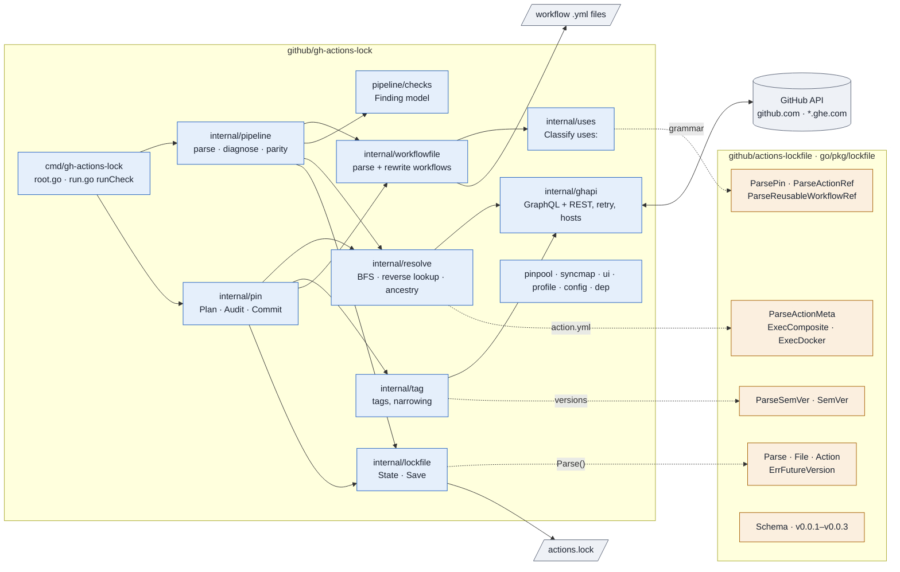
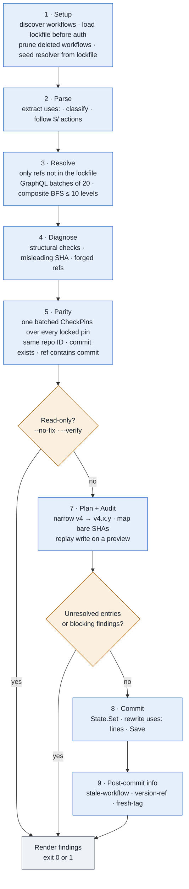

# Actions lockfile code map

What the Go code does in [`github/actions-lockfile`](https://github.com/github/actions-lockfile) and
[`github/gh-actions-lock`](https://github.com/github/gh-actions-lock). One repo defines the
`.github/workflows/actions.lock` format and parses it; the other is the `gh` extension that writes and verifies it.

| | [github/actions-lockfile](https://github.com/github/actions-lockfile) | [github/gh-actions-lock](https://github.com/github/gh-actions-lock) |
|---|---|---|
| Role | Format + parser library | Producer + verifier CLI |
| Shape | One package, `go/pkg/lockfile`, depends only on yaml.v3 | One Cobra command, `gh actions-lock [paths…]` |
| Does | Schema v0.0.1 → v0.0.3; parse, validate, migrate old versions; grammar for pins, `uses:`, semver, action.yml | Resolves every action (and nested composite action) to a commit via the GitHub API; checks pins the way the runner does at job start; rewrites workflows and saves the lockfile, all or nothing |
| Doesn't | Call the network or write files | Define the format (it imports the library as `parserlock`) |

Contents: [Architecture](#architecture) · [actions-lockfile](#githubactions-lockfile) · [gh-actions-lock](#githubgh-actions-lock) · [How they connect](#how-they-connect) · [Sources](#sources)

## Architecture

Packages of the CLI in the order data moves through them, and the parts of the library each one imports.
Dashed arrows are imports of the library. The CLI reads lockfiles through `Parse` but writes YAML with its own marshaller.



## github/actions-lockfile

Module `github.com/github/actions-lockfile/go` (Go 1.19). The README calls it the authoritative definition of the
lockfile format. It parses the file and does not resolve actions, update pins or assess risk; tools that do those
things import it.

### Lockfile format (schema v0.0.3)

```yaml
version: v0.0.3
workflows:                          # workflow path → flat, transitive list of pin keys
  .github/workflows/release.yml:
    - actions/checkout@v6.0.2
dependencies:                       # pin key → resolved metadata (deduplicated graph)
  actions/checkout@v6.0.2:
    hostname: github.com            # optional; omitted = home host
    ref: v6.0.2
    commit: sha1-de0fac2e…          # algorithm-prefixed digest: sha1 or sha256
    owner_id: 44036562              # numeric IDs catch a transferred or replaced repo
    repo_id: 197814629
    uses:                           # direct nested dependencies (composite actions)
      - actions/cache@v4.0.0
```

- **Pin key**: `OWNER/REPO@REF`. Repo granularity only: `actions/cache/save@v4` pins as `actions/cache@v4`, the same
  way the runner downloads it. Owner and repo are lowercased; the ref keeps its case.
- **hostname**: omitted means the home host (the tenant on a GHE.com data-residency instance, or github.com).
  Producers only ever write `github.com` explicitly, for dotcom pins used from a tenant. GHE.com accepts only v0.0.3 files.
- **Older files**: v0.0.1 and v0.0.2 still parse. In memory they get `hostname: github.com`, v0.0.1 `tag`/`branch`
  become `ref`, and `:algo-hex` key suffixes are stripped. The file on disk is not rewritten.

### Files in `go/pkg/lockfile`

| File | What it does |
|---|---|
| `lockfile.go` | `File`, `Action`, `ParseError{Line, Column, Msg}`; constants `Version = "v0.0.3"`, `Path`, `CLIName`, `MaxParseSize` (1 MiB). `Parse(bytes, paths…)`. Field validators: non-empty strings, hostname pattern, algo-hex commit, positive IDs, body `ref` must match the key ref, full-SHA key must match `commit`. Workflow path keys must be safe repo-relative paths (no `..`, absolute paths, `\`, `:` or control characters). Lowercases keys. `detectUsesCycle` guarantees the `uses` graph is acyclic. `File.Position`, `KeyPosition` and `LookupWorkflow` keep the YAML node tree so errors carry line and column. |
| `compat.go` | `parseInternal`, the real parse pipeline. `VersionPolicy{Min, Max}`, `DefaultPolicy`, `ParseWithPolicy`, `ErrUnsupportedVersion`. Allowed and required keys per schema version, duplicate dependency key detection, migrations from v0.0.1 and v0.0.2. When `paths` are given, required-field checks are limited to the entries those workflows use. |
| `pin.go` | `Pin{NWO, Owner, Repo, Ref}`, `ParsePin` (rejects sub-action paths), `Canonical`, `String`, `IndexKey`, `IsFullSha` (40 or 64 hex), `ShortSHA`, digest length checks. |
| `uses.go` | Parses `uses:` strings. `ParseActionRef` returns an `ActionRef` for `owner/repo[/path]@ref` and nil for anything else (docker, local). `ParseReusableWorkflowRef` for `owner/repo/.github/workflows/x.yml@ref`. `IsLocalReusableWorkflow`. Character set, segment and ref validators. |
| `action_meta.go` | `ParseActionMeta` reads action.yml into `ActionMeta{Name, Execution, NestedUses}`; execution is node, docker, composite or unknown. Composite steps' `uses:` become `NestedUses`. Rejects YAML anchors and aliases; 1 MiB cap. |
| `version.go` | Lenient `SemVer` that accepts `v4`, `v4.2` and `2.0.0-rc.1`. `Greater`, `IsStable`, `IsFull`, `IsMutable`, `IsMajorOnly`, `Narrows` (v4.1.0 narrows v4), `UpgradeOver`. |
| `ref.go` | `SplitRef` (stable semver counts as a tag, anything else as a branch), `BestRef`. |
| `nwo.go` | `SplitNWO` splits `owner/repo`. |
| `schema.go` | `Schema()` and `SchemaForVersion()` return the embedded JSON Schemas. `schema_gen.go` is generated by `internal/cmd/genschema` from `schema/lockfile-v0.0.*.json`. |

### Parse pipeline (`compat.go`, `parseInternal`)

1. **Size cap.** Reject anything over 1 MiB before parsing.
2. **YAML to node tree**, then reject duplicate dependency keys with a positioned error, then decode into `File`.
3. **Version.** Required; must be known and inside the `VersionPolicy`. Newer than supported returns `ErrFutureVersion`.
4. **Fields.** Allowed and required keys for that version, value checks, ref and commit consistency.
5. **Workflow paths.** Every key must be a safe repo-relative path.
6. **Migrate.** v0.0.1 fields to v0.0.3; v0.0.1 and v0.0.2 hostnames default to github.com.
7. **Canonicalize.** Lowercase pin keys in `dependencies`, `uses` and `workflows`. Two casings of one pin with different metadata is an error.
8. **Cycle check**, then set `Version` to v0.0.3. Callers always get the current shape.

## github/gh-actions-lock

A `gh` CLI extension built with Cobra: one root command, no subcommands (`cmd/gh-actions-lock/root.go:71`).
It imports `actions-lockfile` v0.0.6 as `parserlock`.

### CLI surface

| Flag | Effect |
|---|---|
| *(none)* | Diagnose, fix what can be fixed, rewrite workflows and save the lockfile. |
| `--no-fix` | Read-only report. |
| `--verify` | Frozen mode for CI. Implies `--no-fix`. |
| `--verify-local` | Offline check that the lockfile covers every workflow. No network, no auth, no run log. |
| `--relock` | Re-resolve everything live and move pins forward. Unreachable pins are still errors. |
| `--accept-moved` | Also accept `unreachable-pin` and `ref-moved`. |
| `--no-narrow` | Keep `v4` instead of narrowing it to `v4.2.1`. |
| `--migrate-local-actions` | Rewrite `./x` local actions to `$/x`. Undone if the run doesn't save. |
| `--no-onboard` | For Dependabot: re-pin tracked actions but don't add new workflows or actions. |
| `--json[=fields]` | Fields: `valid`, `findings`, `workflows`, `dependencies`, `pins`. Bare `--json` means the first three. |
| `--hostname` | Host from the flag, then `GH_HOST`, then the current repo, then github.com. |
| `--profile <dir>` | Write a trace, CPU profile and HTTP log. |

`--verify` can't be combined with `--verify-local`, and `--verify-local` can't be combined with `--relock` or `--accept-moved`.

| Exit code | Meaning |
|---|---|
| **0** | Clean, or every finding was fixed. |
| **1** | Blocking findings remain. Output was already printed. |
| **2** | The tool failed: bad flag, IO, network, corrupt or too-new lockfile. |

Output goes to the terminal (`format/terminal.go`, `pin_summary.go`) or as JSON on stdout (`format/json.go`).
Every run also writes a JSON log to `<UserCacheDir>/gh-actions-lock/logs/`, kept for 14 days or 50 files.

### Packages

| Package | Role |
|---|---|
| `cmd/gh-actions-lock` | Wiring and policy. `runCheck` (`run.go:126`) runs everything; `newRun` (`root.go:191`) does setup. Also `verify.go`, `fresh_tag.go` (cooldown), `onboard_gate.go`, `lockrecovery.go` (never auto-repairs a corrupt lockfile), `runlog.go`, `codespace.go` (SSO hints). |
| `internal/workflowfile` | Workflow YAML model that keeps comments. `ExtractActionRefs`; `walkUses` reads only job, step and composite `uses:`. `ScanSelfRepositoryActions` for `$/` actions. `RewriteActionRefs` edits in place by line and column. `DiscoverWorkflows`, `ValidateInRepo`. |
| `internal/uses` | `Classify`: Action, Local, Docker, Expression, SelfRepository, ReusableWorkflow or Invalid. |
| `internal/ghapi` | The only API client (go-gh REST and GraphQL), with request coalescing. `ResolveActionFiles`: batched GraphQL that turns a ref into a commit plus action.yml and Dockerfile. `CheckPins`: batched parity query. `BatchBranchContains`. `rest_fallback.go`: anonymous REST for SSO-blocked public repos and the Dependabot proxy. `retry.go`: the only retry layer. `hosts.go`: GHE.com tenants. |
| `internal/resolve` | Resolver with caches. `ResolveAllRecursive` (`discovery.go:188`) walks composite actions breadth-first, at most 10 levels deep, 20 refs per GraphQL call. `reverse_lookup.go` maps a bare SHA to a tag or a branch that contains it. `ancestry.go` does the merge-base check that catches forged refs. Also `peel.go`, `images.go`, `pick.go`. |
| `internal/lockfile` | `State`, a mutex-guarded wrapper around `parserlock.File`. `LoadStateAt`, `Closure`, `Set`, `PruneWorkflows`, `SetHostname`, `VerifyHosts`, `Preview`. `Save` removes orphaned entries, writes deterministic YAML (`state_marshal.go`) to a temp file and renames it into place. |
| `internal/pipeline` | Diagnosis: `ParseAll`, resolve, `DiagnoseParsed`, `checkParity`, `checkManifests`, `disposeParity`, `VerifyLocalCoverage`. |
| `pipeline/checks` | `Finding`, `WorkflowReport`, `Report`; the fixed list of finding categories; structural checks; misleading-SHA and ref-moved checks. |
| `internal/pin` | Two-phase write. `Plan` (`plan.go:66`) resolves new refs, narrows partial versions, maps bare SHAs, builds entries. `PlanEntryRepairs`. `Audit` applies the write to a preview and confirms deferred findings are really fixed. `Commit` (`commit.go:32`) updates the lockfile, rewrites workflows in parallel and saves. |
| `internal/tag` | Lists tags and release dates. `BestPatchTagForSHA` does the narrowing. |
| `internal/config` | Cooldown days from `.github/dependabot.yml` (`github-actions` ecosystem, `cooldown.default-days`) or `~/.config/gh-actions-lock/config.yml`. |
| `internal/dep` | `Dependency`, `ParentMap` (child to parents), `Dedup`, `DiffDeps`. |
| `pinpool`, `syncmap`, `ui`, `profile` | Worker pool (8 by default) with spinner rows and a 5-second stall hint; generic mutex map; terminal, headless and NO_COLOR output; profiling. |

### Run flow (`runCheck`)

Steps 1–5 always run. Writes happen only at step 8, and only when nothing is left unresolved.



1. **Setup.** Find `.github/workflows/*.yml`. Load the lockfile before authenticating, so a corrupt or too-new file is
   reported first. Build the API client and resolver. On a full scan, drop entries for deleted workflows. Pin each repo
   to its recorded host. Seed the resolver from the lockfile so locked refs need no API calls (skipped with `--relock`
   or `--accept-moved`).
2. **Parse.** Extract `uses:`, classify each one, follow in-repo `$/` actions, lowercase SHAs, collect container
   images. Malformed refs become load errors.
3. **Resolve.** Send only refs missing from the lockfile to `ResolveAllRecursive`. Each action.yml goes through
   `parserlock.ParseActionMeta`; composite `NestedUses` form the next level; `ParentMap` records the edges. Docker
   images are reported as `container-image` warnings because they can't be locked.
4. **Diagnose**, one workflow per worker. Resolver errors become findings; structural checks; a SHA-looking ref that
   resolves elsewhere gives `misleading-sha`; a ref whose commit isn't an ancestor gives `unreachable-pin`.
5. **Parity.** One batched `CheckPins` over every locked pin, repeating what the runner checks at job start. A
   different repo ID gives `repo-replaced`; a rename gives `repo-renamed`. A commit missing from the ref's history
   gives `unreachable-pin`, which blocks commits injected from a fork. An exact tag that moved gives
   `tag-commit-mismatch`. Then `checkManifests` checks recorded `uses` edges.
6. **Gate.** `--no-fix` and `--verify` print here and exit. `--no-onboard` turns new items into `onboarding-required`
   info findings.
7. **Plan and audit.** Narrow direct `v4` refs to the highest full tag on the same commit. Map bare SHAs to a tag or
   branch. `Audit` replays the write on a preview. Any unresolved entry or blocking finding stops the write.
8. **Commit.** `State.Set` per workflow (repo and owner IDs fetched when needed), rewrite `uses:` lines, `Save`.
9. **Post-commit info.** `stale-workflow`, `version-ref`, and `fresh-tag` for tags released inside the cooldown
   window (3 days by default). Cooldown never blocks pinning.

### Finding categories

Defined in `internal/pipeline/checks/category.go`. The security checks that come from parity and ancestry are in bold.

`not-pinned` · `ref-missing` · `ref-changed` · **`ref-moved`** · **`tag-commit-mismatch`** · `stale` ·
**`misleading-sha`** · **`unreachable-pin`** · `repo-renamed` · **`repo-replaced`** · `repo-unavailable` ·
`ancestry-unknown` · `reachability-unknown` · `onboarding-required` · `version-ref` · `local-action` ·
`stale-workflow` · `fresh-tag` · `cooldown-config-ignored` · `incomplete-lockfile` · `container-image`

### Design points

- **Concurrency.** One shared worker pool (8 workers) for resolve, diagnose, plan and manifest reads. Caches are mutex
  maps paired with singleflight, so identical API calls run once. Shared fetches use contexts that one caller can't
  cancel for the others.
- **Caching.** In memory, per run. Cache keys lowercase owner, repo and SHA but keep ref case (`ghapi/cachekey.go`).
  With the lockfile seeded, a repeat run makes almost no API calls beyond the parity batch.
- **Retries.** Patient in CI or behind the Dependabot proxy (8 attempts, 2-minute window); quick locally (3 attempts,
  10 seconds). Retries 5xx, 429, rate-limit 403s and GraphQL `RATE_LIMITED`, with jittered backoff that honours
  `Retry-After`. A check that gets no answer becomes a retryable `reachability-unknown` and fails closed.
- **Hosts.** github.com and GHE.com data-residency tenants (called Proxima in the code). On a tenant, github.com is
  called anonymously, only after a repo-level 404, so `GH_TOKEN` never leaves the tenant. GHES is documented as
  unsupported, though a leftover v0.0.2 code path still exists (`state.go:238`).
- **Safety.** All-or-nothing writes with temp-file rename. Lockfile loaded before auth. Corrupt lockfiles are never
  auto-repaired. Workflow paths must stay inside the repo, symlinks included. Runs on explicit paths never prune other
  workflows.
- **Environment variables.** `GH_ACTIONS_LOCK_WORKFLOWS_DIR`, `GH_ACTIONS_LOCK_REPO_ROOT`,
  `GH_ACTIONS_LOCK_DEPENDABOT_PROXY`, `GH_ACTIONS_LOCK_CONFIG`, `GH_ACTIONS_LOCK_INSECURE`,
  `GH_ACTIONS_LOCK_STALL_HINT_MS`; `CI` and `GITHUB_ACTIONS` pick the retry policy.

## How they connect

| actions-lockfile owns | gh-actions-lock owns |
|---|---|
| The schema and its versions | Every GitHub API call |
| Reading and validating lockfiles | Resolution, parity, ancestry, narrowing |
| Migrating v0.0.1 and v0.0.2 in memory | Rewriting workflow files |
| The grammar of pins, `uses:`, versions and action.yml | Writing the lockfile, with its own YAML marshaller |

| Library API | Used in gh-actions-lock |
|---|---|
| `Parse`, `File`, `Action`, `Version`, `Path`, `ErrFutureVersion` | `internal/lockfile/state.go`, `state_marshal.go` |
| `Pin`, `ParsePin` | `internal/lockfile`, `pipeline/parity.go`, `manifests.go`, `checks`, `pin`, `verify.go` |
| `ActionRef`, `ParseActionRef` | Almost every package; it is the standard type for a `uses:` ref |
| `ParseReusableWorkflowRef`, `IsLocalReusableWorkflow` | `internal/uses`, `internal/workflowfile` |
| `IndexKey`, `SplitNWO`, `SplitRef`, `BestRef` | `onboard_gate.go`, `convertor.go`, `dep`, `format/url.go`, `pin_summary.go`, `pin/repair.go` |
| `IsFullSha`, `ShortSHA` | Many files |
| `ParseSemVer`, `SemVer` | `resolve/pick.go`, `discovery.go`, `tag`, `pin/plan.go`, `fresh_tag.go`, `parity.go` |
| `ParseActionMeta`, `ExecComposite`, `ExecDocker` | `resolve/discovery.go` (`CompositeUses`), `resolve/images.go` |

## Sources

Read from the `main` branch of both repositories on 2026-10-22. The actions-lockfile section comes from reading its
source directly. The gh-actions-lock section comes from a reading of its non-test sources; line numbers there are
approximate.
